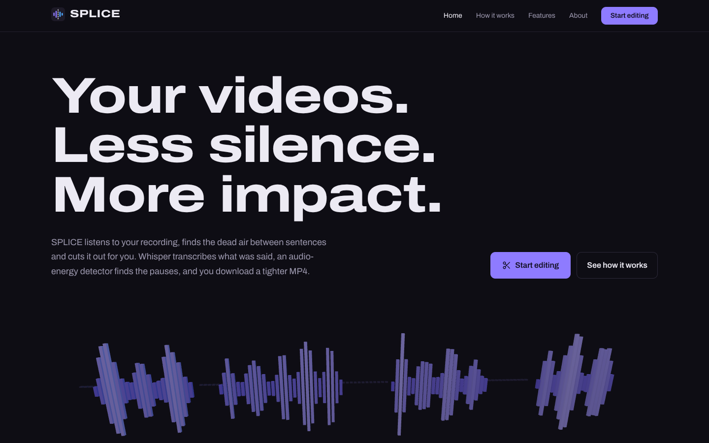
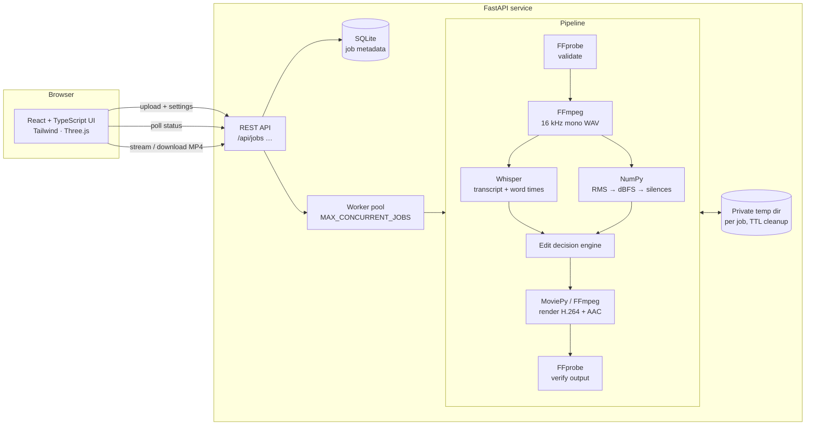
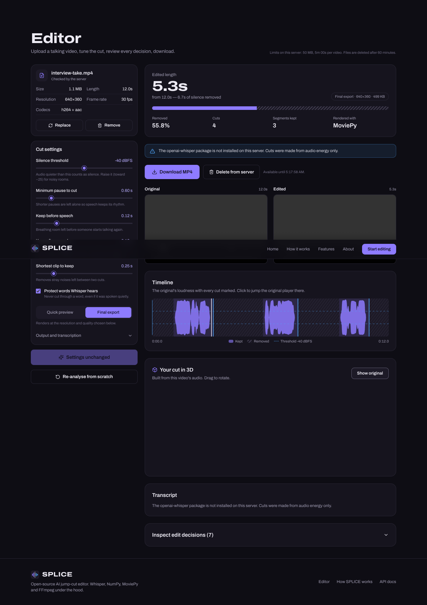
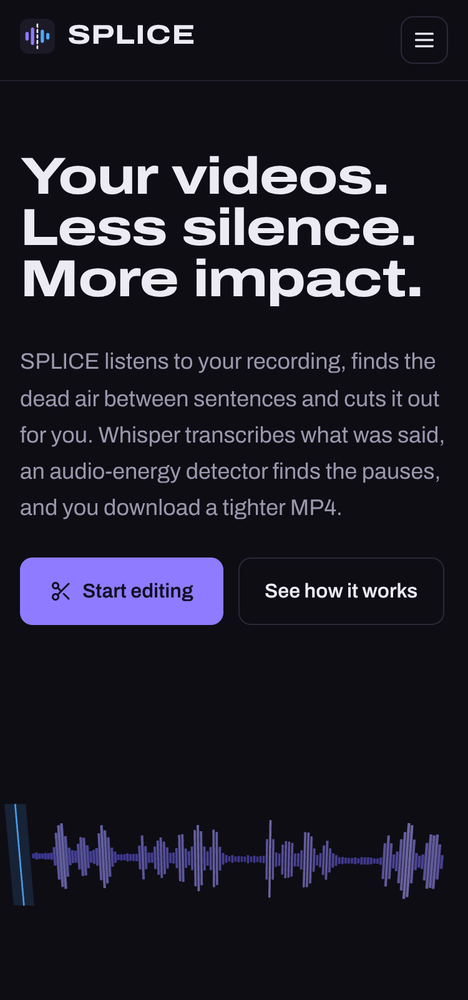

# SPLICE — automatic jump cuts for talking videos

**SPLICE** removes dead air from talking-head videos. Upload a clip, choose how tight the edit should be, and SPLICE
transcribes the speech with **OpenAI Whisper**, measures silence directly from the audio with **NumPy**, builds an
inspectable edit decision list, and renders a clean **H.264/AAC MP4** with **MoviePy + FFmpeg**.

> **Live demo:** https://splice-chi.vercel.app · API: https://splice-iloh.onrender.com/api/docs
>
> Runs on free tiers: the backend sleeps when idle, so the first request can take about a minute, and processing a clip takes a few minutes on a 0.1-CPU instance.



## Why

Recording a tutorial, lecture or interview always leaves pauses — thinking time, false starts, long breaths. Cutting
them by hand means scrubbing the timeline and making dozens of jump cuts. SPLICE does that pass automatically, but
keeps every decision visible and adjustable, so the edit stays under your control.

## Features

- **Drag-and-drop upload** with browser-side checks and server-side FFprobe validation (container, streams, duration,
  resolution, frame rate; clear errors for corrupt files, audio-only files or videos without sound).
- **Whisper transcription** (local, open-source — no API key) with segment and word timestamps.
- **Energy-based silence detection**: 30 ms frames, RMS → dBFS, configurable threshold and minimum pause.
- **Speech protection**: words Whisper heard are never cut, even if spoken quietly.
- **Edit decision engine**: padding before/after speech, no micro-cuts, stray-noise removal, optional max length —
  one validated list drives both the renderer and the UI.
- **Rendering** with MoviePy (`subclipped` + `concatenate_videoclips`) or a single FFmpeg filter-graph pass for long
  videos; frame-accurate re-encode, resolution/quality presets, optional audio removal; output verified by FFprobe.
- **Real progress**: genuine job states from the backend; percentages only where measurable (render, faster-whisper).
- **Results workspace**: original vs edited players, stats, clickable loudness timeline with every cut, a **3D view of
  your own video's audio** that collapses the removed sections, timestamped transcript, full edit-decision table.
- **Re-render** with new cut/output settings without re-transcribing (cached audio + transcript).
- **Privacy & safety**: random job ids + secret per-job access tokens (stored hashed), private temp storage, TTL
  cleanup, orphan sweeping, size/duration/concurrency/time limits, per-IP rate limit, restrictive CORS, no stack traces
  or paths in responses, no media or transcripts in logs.

## Architecture



More detail, including the algorithms, in [docs/ARCHITECTURE.md](docs/ARCHITECTURE.md).

## Tech stack

| Layer | Technology | Role |
| --- | --- | --- |
| Speech recognition | OpenAI Whisper (`openai-whisper`, or `faster-whisper` with the same weights) | Transcript + word timestamps |
| Signal processing | NumPy (SciPy available) | Framing, RMS energy, dBFS, silence intervals |
| Media | FFmpeg / FFprobe | Validation, audio extraction, encoding |
| Editing | MoviePy 2 | Sub-clipping and concatenation |
| API | FastAPI, Uvicorn, Pydantic | Uploads, jobs, downloads, validation |
| Storage | SQLite + temp files | Short-lived job metadata and media |
| Frontend | React 19, TypeScript, Vite, Tailwind CSS 4, Lucide | Landing page, editor, results |
| 3D | Three.js | Hero animation and per-job 3D cut view |
| Quality | pytest, Vitest + Testing Library, Playwright, Ruff, GitHub Actions | Tests, lint, CI |

## How the AI pipeline works

1. **Validate** — FFprobe reads the upload; files without video or audio, corrupt files, or files over the size or
   duration limit are rejected before a job is created.
2. **Extract audio** — FFmpeg decodes the first audio track once to 16 kHz mono PCM, the format Whisper expects.
3. **Transcribe** — Whisper produces segments and word timings. Whisper is a *transcription* model: its timestamps are
   approximate, so SPLICE never cuts on transcript gaps alone.
4. **Detect silence** — see below.
5. **Plan** — silences become cut candidates, shrunk by padding, minus any words Whisper heard, without micro-cuts;
   the result is validated (contiguous, in-bounds, non-empty).
6. **Render** — MoviePy (or one FFmpeg pass) renders exactly the retained segments; FFprobe checks the result.

### Silence-detection algorithm

```
waveform (16 kHz) ─► frames: 30 ms window, 10 ms hop
                  ─► RMS per frame = sqrt(mean(x²))
                  ─► dBFS = 20·log10(max(RMS, 10^-5))      # floor at −100 dBFS, never log(0)
                  ─► silent = dBFS < threshold              # default −40 dBFS
                  ─► runs of silent frames → intervals     # leading/trailing runs snap to 0 and the end
                  ─► merge intervals split by < 60 ms blips (clicks, breaths)
                  ─► keep intervals ≥ minimum pause         # default 0.5 s
```

Each silence `[s, e]` becomes a cut `[s + pad_after, e − pad_before]` (no padding at the very start/end), Whisper word
spans (+50 ms guard) are subtracted, cuts under 80 ms are skipped, and kept segments shorter than the minimum clip
length are dropped. If nothing is left, the original is kept rather than producing an empty video.

## Run it locally

You need **Git**, **Python 3.11**, **Node.js 20 LTS** and **FFmpeg** (`ffmpeg` and `ffprobe` on PATH). Full,
OS-by-OS instructions (Windows first) are in [docs/LOCAL_SETUP.md](docs/LOCAL_SETUP.md). The short version:

**Terminal 1 — backend**

```powershell
cd backend
py -3.11 -m venv .venv
.\.venv\Scripts\Activate.ps1            # macOS/Linux: source .venv/bin/activate
pip install -r requirements.txt          # API + OpenAI Whisper (downloads PyTorch)
copy .env.example .env                   # macOS/Linux: cp .env.example .env
uvicorn app.main:app --reload --port 8000
```

**Terminal 2 — frontend**

```powershell
cd frontend
npm install
npm run dev                              # http://localhost:5173 (proxies /api to :8000)
```

Open <http://localhost:5173>, upload a short clip and press **Remove silence**. The first job downloads the Whisper
`tiny` weights (~75 MB) once.

## Configuration

Backend settings come from environment variables or `backend/.env` (see [`backend/.env.example`](backend/.env.example)).
They are validated at startup; invalid values stop the server with a readable message.

| Variable | Default | Meaning |
| --- | --- | --- |
| `FRONTEND_ORIGINS` | `http://localhost:5173` | Comma-separated origins allowed by CORS |
| `FRONTEND_DIST` | — | Serve the built UI from the API process (single-URL deploys) |
| `MAX_UPLOAD_MB` / `MAX_VIDEO_DURATION_SECONDS` | `50` / `300` | Upload limits |
| `MAX_CONCURRENT_JOBS` / `MAX_QUEUED_JOBS` | `1` / `4` | Worker pool size and queue bound |
| `JOB_TIMEOUT_SECONDS` | `900` | Hard limit per job |
| `JOB_TTL_MINUTES` / `CLEANUP_INTERVAL_MINUTES` | `60` / `5` | Retention and sweep frequency |
| `RATE_LIMIT_JOBS_PER_HOUR` | `20` | Per-IP uploads (0 disables) |
| `WHISPER_ENGINE` | `openai-whisper` | `openai-whisper`, `faster-whisper` or `none` |
| `WHISPER_MODEL` / `WHISPER_ALLOWED_MODELS` | `tiny` / `tiny,base` | Default and selectable models |
| `WHISPER_DEVICE` | `cpu` | `cpu`, `cuda` or `auto` |
| `RENDER_ENGINE` | `auto` | `auto` (MoviePy for short clips), `moviepy` or `ffmpeg` |
| `TEMP_DIR` | `./tmp` | Private working directory |

Frontend: `VITE_API_BASE_URL` (empty = same origin) and `VITE_SOURCE_REPO_URL`, see `frontend/.env.example`.

## API

Interactive docs at `/api/docs`. Every job endpoint needs the `access_token` returned on creation, sent as
`X-Job-Token` (or `?token=` for `<video>`/download links).

| Method & path | Purpose |
| --- | --- |
| `GET /api/health` | Status, FFmpeg/Whisper availability, active jobs |
| `GET /api/config` | Public limits, models and default settings |
| `POST /api/jobs` | Multipart upload: `file` + `settings` (JSON) → `{job_id, access_token, job}` |
| `GET /api/jobs/{id}` | Status, stage, progress, source metadata, result summary |
| `GET /api/jobs/{id}/transcript` | Timestamped transcript |
| `GET /api/jobs/{id}/edit-plan` | Edit decisions, silences, loudness envelope |
| `POST /api/jobs/{id}/render` | Re-render with new settings (reuses audio + transcript) |
| `GET /api/jobs/{id}/download` | The MP4 (`?inline=1` for playback; supports Range) |
| `DELETE /api/jobs/{id}` | Delete files and metadata (cancels if running) |

Errors always look like `{"error": {"code": "...", "message": "...", "details": {}}}`.

## Tests

```bash
cd backend && pytest                                  # 85 tests (1 opt-in): algorithms, API, FFmpeg rendering, cleanup
SPLICE_RUN_WHISPER=1 pytest -m whisper                # opt-in: real Whisper on synthesized speech
cd frontend && npm test                               # Vitest + Testing Library
python scripts/smoke_test.py --base-url http://localhost:8000   # end-to-end against a running server
python scripts/e2e_ui.py --base-url http://localhost:8000       # browser E2E (needs: pip install playwright)
```

The smoke test generates a video with synthesized speech (FFmpeg's `flite`) and silences, uploads it, waits for the
real pipeline, checks transcript/silences/decisions, downloads the MP4, validates it with FFprobe and deletes the job.

## Deployment

Recommended free setup: **one Docker web service on Render** (API + UI in one container) — optionally with the UI also
on **Vercel** so it loads instantly while the free backend wakes up. Step-by-step instructions, the Hugging Face
alternative and verification steps are in [docs/DEPLOYMENT.md](docs/DEPLOYMENT.md).

## Limitations

- **CPU-only free hosting is slow.** Render's free instance has 0.1 CPU and 512 MB RAM, so a 60-second clip can take
  several minutes. The free config therefore limits clips to 90 s / 30 MB and uses `faster-whisper` `tiny` (int8).
- **Free instances sleep** after ~15 minutes idle; the first request takes about a minute.
- **Storage is temporary.** Restarts and redeploys wipe files and job metadata; jobs running during a restart are
  reported as failed.
- **Single instance.** Jobs run in a thread pool inside the API process; the in-memory rate limiter isn't shared.
- **Energy detection is heuristic.** Music beds, constant noise or very quiet speakers need threshold tuning.
- **Access tokens are capability links**, not user accounts. Anyone holding a link can view that job until it expires.
- Remaining abuse risk for a public demo: someone can still upload many small files from many IPs; limits keep the
  cost bounded but don't prevent it.

## Future improvements

- Durable queue (Redis/RQ or a managed queue) and object storage for multi-instance scaling.
- Neural VAD (Silero) as an alternative detector; filler-word ("um", "uh") removal from word timestamps.
- Server-Sent Events instead of polling; resumable uploads.
- Export an EDL/XML for Premiere/DaVinci instead of only a rendered MP4.
- GPU inference for larger Whisper models.

## Screenshots

Captured from the running app with headless Chromium (`python scripts/e2e_ui.py --screenshots docs/screenshots`).
That browser has no H.264 decoder, so the two video players appear empty in these images; in Chrome, Edge, Safari or
Firefox they play normally. Re-run the command against your deployment to refresh them.

| Editor results | Mobile |
| --- | --- |
|  |  |

## Contributing

Issues and pull requests are welcome. Please run `ruff check . && pytest` in `backend/` and
`npm run typecheck && npm test` in `frontend/` before opening a PR; CI runs the same checks.

## License

[MIT](LICENSE). Whisper model weights are released by OpenAI under the MIT license.
